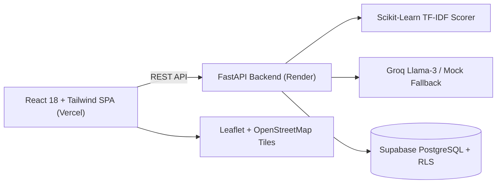

# Personalized Travel Itinerary Planner (YatraAI)

[](https://github.com/placeholder/travel-itinerary-planner/actions)
[](https://fastapi.tiangolo.com)
[](https://react.dev)
[](https://tailwindcss.com)
[](https://supabase.com)
[](https://opensource.org/licenses/MIT)

**Demo Link**: [https://yatra-ai-planner.netlify.app](https://yatra-ai-planner.netlify.app)  
**GitHub Link**: [https://github.com/placeholder/travel-itinerary-planner](https://github.com/placeholder/travel-itinerary-planner)

---

## 1. Overview & Vision

**Personalized Travel Itinerary Planner (YatraAI)** is an AI-powered travel application designed from scratch for the Indian market. It generates realistic, bespoke, day-by-day travel itineraries based on destination, travel dates, budget, interests, group size, and travel style.

All costs are natively calculated in Indian Rupees (₹) with `en-IN` number formatting (`₹1,25,000`). Logistical scheduling respects Indian realities: auto-rickshaws, metro lines, walking heritage loops, dhabas, local trains, and climate-conscious afternoon rests.

---

## 2. Key Features

- **5-Step Smart Trip Builder**:
  1. *Destination, Dates & Group Size*: 25+ Indian autocomplete suggestions (Indore, Bhopal, Jaipur, Goa, Varanasi, etc.) or any custom destination.
  2. *Interactive Budget Slider*: Configurable budget in ₹ with real-time per-day calculations.
  3. *Multi-select Interests*: Sightseeing, Food & Street Food, Culture, Nature, Adventure, Relaxation, Nightlife, and Shopping.
  4. *Pacing & Dietary Styles*: Relaxed, Balanced, or Packed paces + Vegetarian, Jain, Non-Veg, or Any dietary options.
  5. *Live Preview & Review*: Instant recommendations preview from the recommendation scoring service before generation.
- **AI-Powered Generation**:
  - LLM prompt engineering with Llama-3 (Groq or Together) and configurable Gemini/OpenAI adapters.
  - Strict Pydantic JSON validation and automated repair for unescaped characters.
  - Resilient offline mock generator that activates automatically if no API key is provided.
- **Interactive Day Timeline & Leaflet Map**:
  - Day tabs with activity cards categorizing attractions, dining, stays, and transit.
  - Interactive OpenStreetMap with numbered markers matching each day's stops.
  - Single-day regeneration modal ("Regenerate this Day") with custom instructions while preserving the rest of your itinerary.
  - Drag-and-drop / inline order controls to easily adjust schedule.
- **Financial Tracker & Cost Breakdown**:
  - Clear visual breakdown of estimated costs across Stays, Food, Activities, and Transit.
  - Budget alert badge indicating whether the plan is within the target.
- **Group Trips & Collaboration**:
  - Invite companions by email with Editor or Viewer roles.
  - One-click copyable share link.
- **Print & PDF Export**:
  - Printer-optimized layout for offline reference during travel.

---

## 3. User Guide: 3 Real-World Scenarios

```
+---------------------------------------------------------------------------------+
|                                 YatraAI UI                                      |
|  [ Solo Weekend: Indore ]   [ Romantic Couple: Jaipur ]   [ Friends: Goa ]      |
+---------------------------------------------------------------------------------+
```

### Scenario 1: Solo Weekend in Indore (Street Food & Heritage)
1. On the landing page, click **Launch Plan** on the *Solo Weekend Explorer* card.
2. The builder pre-populates **Indore**, a **₹12,000** budget, and **Food & Culture** interests.
3. Click **Generate Itinerary** to receive a schedule featuring Sarafa Bazaar night stalls, Rajwada Palace, Chappan Dukan, and local auto-rickshaw transit.

### Scenario 2: Romantic Couple Vacation in Jaipur
1. Choose **Romantic Couple Vacation** with destination **Jaipur** and **₹45,000** budget.
2. The generated plan schedules slow mornings at Shahpura House, Sheesh Mahal inside Amber Fort, and an evening dinner at 1135 AD inside the fort ramparts.
3. Click **Regenerate Day 2** with the custom tweak *"Add Nahargarh sunset viewpoint"* to update that day dynamically.

### Scenario 3: Friends Coastal Getaway in Goa
1. Select **Friends Coastal Getaway** with destination **Goa** and **4 Travelers**.
2. The generated itinerary balances South Goa beaches (Palolem), Dudhsagar waterfall excursions, scooter rentals, and Assagao dining.
3. Click **Share** to invite friends via email and give them editor permissions.

---

## 4. System Requirements

| Specification | Minimum | Recommended |
|---|---|---|
| **CPU** | Intel Core i5 (8th Gen+) / AMD Ryzen 5 (3000 series+) | 4+ physical cores (Apple Silicon or modern x86) |
| **RAM** | 8 GB | 16 GB |
| **Disk Space** | 2.5 GB free space | 5 GB free space |
| **GPU** | None required | Optional |
| **Network** | Active internet connection | Broadband connection for maps & LLM |

---

## 5. System Architecture



See [`docs/architecture.md`](docs/architecture.md) for full sequence diagrams and component details.

---

## 6. Environment Variables Reference

Never commit secrets. Configure these variables in `.env` files:

### Backend (`backend/.env`)
- `PORT`
- `ENVIRONMENT`
- `CORS_ORIGINS`
- `SUPABASE_URL`
- `SUPABASE_ANON_KEY`
- `SUPABASE_SERVICE_ROLE_KEY`
- `LLM_PROVIDER`
- `LLM_API_KEY`
- `LLM_MODEL`

### Frontend (`frontend/.env`)
- `VITE_API_BASE_URL`
- `VITE_SUPABASE_URL`
- `VITE_SUPABASE_ANON_KEY`

---

## 7. Local Development Setup

### Windows PowerShell Commands

```powershell
# 1. Clone repository
git clone https://github.com/placeholder/travel-itinerary-planner.git
cd "Personalized Travel Itenary Planner"

# 2. Setup Backend Virtual Environment
python -m venv backend/venv
.\backend\venv\Scripts\Activate.ps1
pip install -r backend/requirements.txt
cp backend/.env.example backend/.env

# 3. Start Backend Development Server
uvicorn backend.app.main:app --reload --port 8000

# 4. In a separate terminal, setup Frontend
cd frontend
npm install
cp .env.example .env
npm run dev
```

Visit [http://localhost:5173](http://localhost:5173) in your browser.  
FastAPI Swagger documentation is live at [http://localhost:8000/docs](http://localhost:8000/docs).

---

## 8. Automated Testing

```powershell
# Run backend pytest test suite (18 tests)
$env:PYTHONPATH="."
.\backend\venv\Scripts\pytest.exe backend/tests -v

# Run frontend Vitest suite (5 tests)
cd frontend
npm test

# Run frontend production build
npm run build
```

---

## 9. API Reference Summary

- `GET /health` — Service health check & environment info
- `GET /api/preferences` — Get saved user preferences
- `POST/PUT /api/preferences` — Save traveler preferences
- `POST /api/recommendations` — Scored attractions, dining, and transit
- `POST /api/itineraries/generate` — Generate multi-day itinerary
- `POST /api/itineraries/{trip_id}/days/{day}/regenerate` — Regenerate specific day
- `POST /api/itineraries/{trip_id}/days/{day}/items` — Add activity item
- `PUT /api/itineraries/{trip_id}/items/{item_id}` — Edit activity item
- `DELETE /api/itineraries/{trip_id}/items/{item_id}` — Delete activity item
- `PUT /api/itineraries/{trip_id}/days/{day}/reorder` — Reorder stops
- `GET /api/trips` — List trips for user
- `GET /api/trips/{id}` — Retrieve trip with days and map coordinates
- `DELETE /api/trips/{id}` — Delete trip
- `POST /api/trips/{id}/members` — Invite collaborators by email
