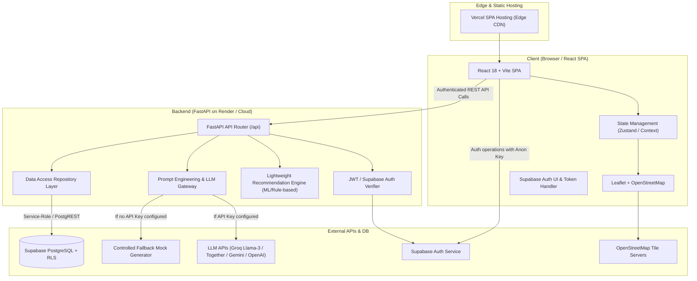
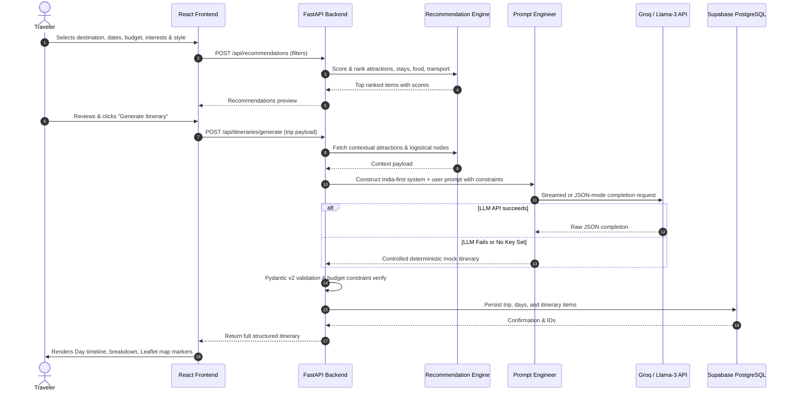

# System Architecture & Technical Specification

## 1. System Requirements & Hardware Guidelines

- **Processor**: Intel Core i5 (8th Gen or newer) / AMD Ryzen 5 (3000 series or newer) or Apple Silicon / Cloud vCPU (minimum 2 vCPU).
- **RAM**: Minimum 8 GB recommended (4 GB bare minimum for local dev).
- **Disk Space**: At least 2.5 GB free storage for monorepo code, node_modules, Python virtualenv, and build artifacts.
- **GPU**: Optional. The recommendation engine runs lightweight vector/rule scoring; heavy local transformers are not required.
- **Network**: Active broadband connection for Google Fonts, Leaflet tile servers (OpenStreetMap), Supabase Cloud, and LLM inference endpoints (Groq / Together / Gemini / OpenAI).

---

## 2. High-Level System Architecture

---

## 3. Data Flow: Itinerary Generation Lifecycle

---

## 4. Key Security & Operational Principles

1. **Defense-in-Depth RLS**: Row Level Security ensures users can only read, update, or delete trips they own or are members of.
2. **Secret Isolation**: Frontend only holds `VITE_SUPABASE_ANON_KEY`. Backend holds `SUPABASE_SERVICE_ROLE_KEY` and `LLM_API_KEY`.
3. **Graceful Fallbacks**: If external LLM keys are absent, system automatically falls back to an offline-capable mock generator with explanatory UI badges.
4. **Strict en-IN Financials**: INR (`₹`) formatting strictly standardized using `Intl.NumberFormat('en-IN')` without currency ambiguity.
